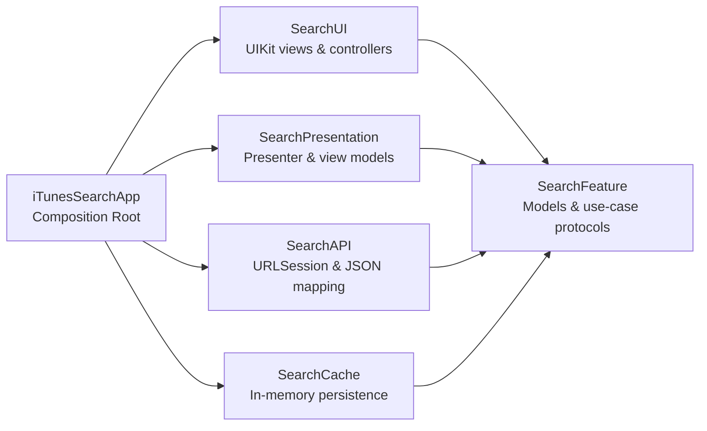
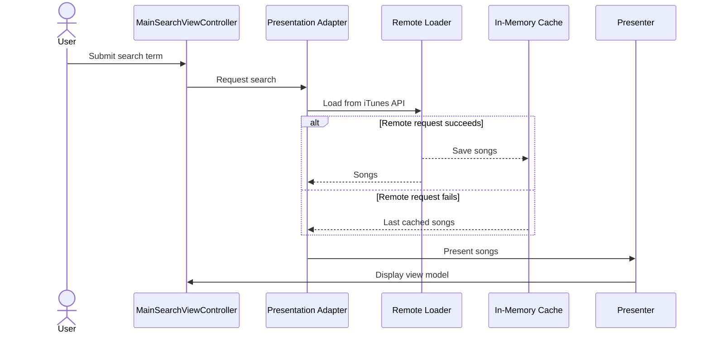

<div align="center">

# iTunes Search

### A modular iOS music discovery app built with Swift, UIKit, and Clean Architecture

Search Apple Music's catalog, inspect song metadata and artwork, and play audio previews—all through a codebase designed around explicit boundaries, dependency inversion, and testability.

[](https://swift.org)
[](https://developer.apple.com/ios/)
[](https://developer.apple.com/documentation/uikit)
[](#architecture)
[](#license)

</div>

## Why this project stands out

iTunes Search is more than an API demo. It is an exploration of how to keep an iOS feature maintainable as it grows. The domain model has no framework dependencies, infrastructure details sit behind protocols, UI and presentation concerns are separated, and the app target acts as the **composition root** where concrete implementations are connected.

Engineering highlights:

- **Five local Swift packages** enforce boundaries at compile time.
- **Protocol-oriented design** keeps URL loading, caching, image loading, and presentation replaceable.
- **Decorator and Composite patterns** add caching and offline fallback without changing the remote loader.
- **Dependency injection** is performed explicitly at the application boundary—no service locator or global mutable state.
- **Functional core, imperative shell** keeps domain contracts small while side effects remain in infrastructure modules.
- **Test doubles and memory-leak tracking** verify API behavior without making real network requests.
- **Native Apple frameworks only**: UIKit, URLSession, AVFoundation, XCTest, and Swift Package Manager.

## Features

- Search for songs using Apple's iTunes Search API
- Browse track, artist, album, and artwork information
- Open a dedicated details screen
- Stream the public song preview with `AVPlayer`
- Load artwork asynchronously
- Cache successful searches in memory
- Fall back to cached results when the remote request fails
- Track screen appearances and song selections through a lightweight analytics boundary

## Architecture

The app follows Clean Architecture principles: source-code dependencies point toward the feature contracts, while concrete networking, caching, presentation, and UI implementations remain at the edges.



### Module responsibilities

| Module | Responsibility | Key types |
| --- | --- | --- |
| `SearchFeature` | Framework-independent domain model and use-case contracts | `Song`, `SearchLoader`, `SearchCache`, `SearchImageDataLoader` |
| `SearchAPI` | HTTP transport, iTunes JSON mapping, and remote image data | `URLSessionHTTPClient`, `RemoteSearchLoader`, `SearchItemsMapper` |
| `SearchCache` | Local search persistence and retrieval | `InMemorySearchChace`, `LocalSearchLoader` |
| `SearchPresentation` | Converts use-case output into UI-ready state | `SearchPresenter`, `SearchViewModel` |
| `SearchUI` | UIKit search screen and table-view data source | `MainSearchViewController`, `MainSearchDataSource` |
| `iTunesSearchApp` | Dependency composition, navigation, analytics, and details playback | `AppDelegate`, `SearchUIComposer`, loader decorators/composites |

### Search data flow



The behavior is assembled with small, focused objects:

```swift
SearchLoaderWithFallbackComposite(
    primary: SearchLoaderCacheDecorator(
        decoratee: remoteSearchLoader,
        searchCache: inMemorySearchCache
    ),
    fallback: localSearchLoader
)
```

This composition makes the policy visible: **try remote → cache success → use local data on failure**. Each object has one reason to change and can be tested independently.

## Tech stack

| Area | Technology |
| --- | --- |
| Language | Swift 5 |
| UI | UIKit, XIB, programmatic composition |
| Networking | URLSession with an ephemeral configuration |
| Media | AVFoundation / `AVPlayer` |
| Concurrency | Escaping closures and main-thread UI dispatch |
| Modularity | Swift Package Manager |
| Testing | XCTest, spies, stubs, and memory-leak assertions |
| API | Apple iTunes Search API |

## Testing strategy

The test suite exercises observable behavior at architectural boundaries rather than implementation details. The remote-search use case verifies:

- The requested URL and request count
- Client-error propagation
- Rejection of non-`200` HTTP responses
- Rejection of malformed JSON
- Empty and populated response mapping
- Deallocation of the system under test through reusable memory-leak assertions

The cache package also verifies save-and-retrieve behavior. HTTP interactions use an `HTTPClientSpy`, keeping tests deterministic and independent of network availability.

## Getting started

### Requirements

- macOS with Xcode 12 or later
- iOS 13.6 or later
- An internet connection for live searches and audio previews

### Run the app

1. Clone the repository:

   ```bash
   git clone https://github.com/mduranx64/iTunes-Search.git
   cd iTunes-Search
   ```

2. Open the Xcode project:

   ```bash
   open iTunesSearchApp/iTunesSearchApp.xcodeproj
   ```

3. Select the `iTunesSearchApp` scheme and an iOS Simulator.
4. Build and run with <kbd>⌘R</kbd>.

The app uses local package references, so Xcode resolves every module directly from this repository. No third-party dependencies or API keys are required.

### Run tests

In Xcode, select the app scheme and press <kbd>⌘U</kbd>. Individual Swift packages can also be opened from their `Package.swift` manifests and tested independently.

## Project structure

```text
iTunes-Search/
├── SearchFeature/       # Domain entities and use-case protocols
├── SearchAPI/           # Remote loading, HTTP client, and mapping
├── SearchCache/         # In-memory cache and local loader
├── SearchPresentation/  # Presenter and view models
├── SearchUI/            # Reusable UIKit search interface
└── iTunesSearchApp/     # Composition root, navigation, details, analytics
```

## Design decisions

### Why separate Swift packages?

Folders communicate intent; modules enforce it. Packaging each architectural area prevents accidental coupling and makes dependencies reviewable in each `Package.swift` manifest.

### Why protocols at the feature boundary?

`SearchLoader`, `SearchCache`, and `SearchImageDataLoader` describe what the application needs without prescribing URLSession, memory storage, or any other implementation. Infrastructure depends on these contracts—not the other way around.

### Why compose decorators instead of expanding the loader?

Caching and fallback are policies separate from networking. `SearchLoaderCacheDecorator` and `SearchLoaderWithFallbackComposite` add those behaviors while preserving the single responsibility of `RemoteSearchLoader`.

## Future improvements

- Adopt Swift concurrency (`async`/`await`) and structured cancellation
- Add persistent disk caching with an expiration policy
- Encode search terms with `URLComponents` and use HTTPS throughout
- Add loading, empty, and recoverable error states to the presentation layer
- Add snapshot/UI tests and continuous integration
- Improve accessibility labels, Dynamic Type support, and localization

## Author

**Miguel Duran** — iOS developer focused on modular architecture, testable design, and maintainable product code.

- GitHub: [@mduranx64](https://github.com/mduranx64)

## License

No license has been specified for this repository. All rights are reserved by the author unless a license is added.
